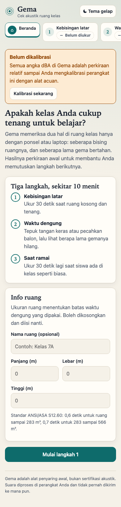
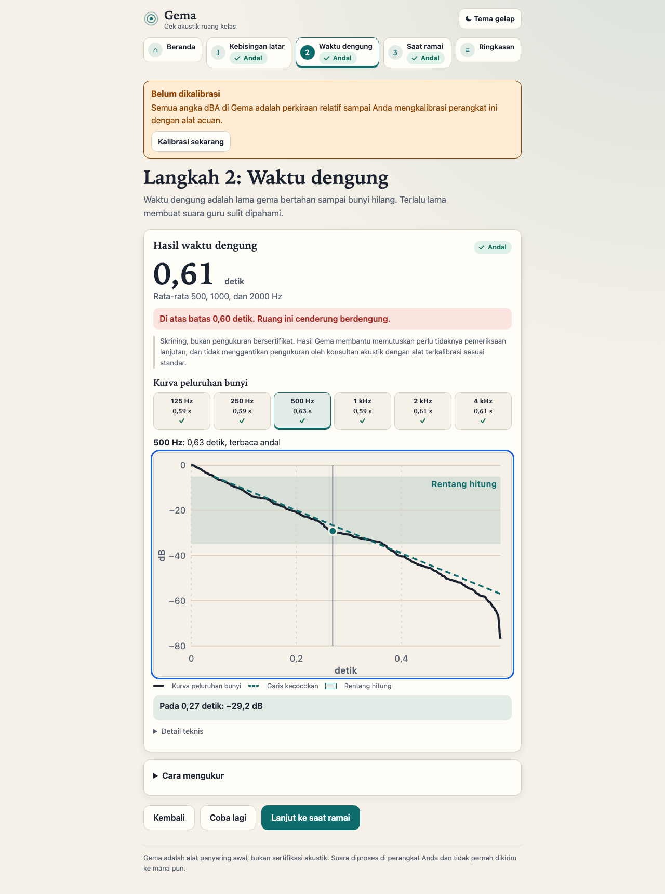
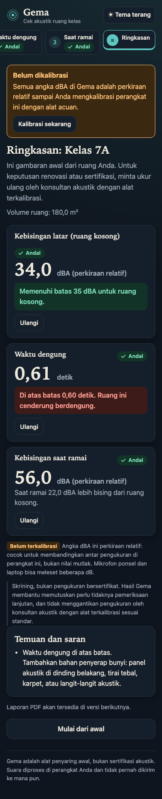

<div align="center">

# GEMA

**Pemeriksa akustik kelas langsung dari browser.**
Ukur kebisingan latar dan waktu dengung (RT60) ruang kelas dengan mikrofon ponsel atau laptop, lalu dapatkan saran perbaikan yang konkret.

[](LICENSE)






</div>

---

## Mengapa GEMA

Kelas yang bising dan bergema membuat murid sulit menangkap suara guru. Mengukurnya biasanya butuh alat mahal dan tenaga ahli. GEMA memandu siapa saja, guru, kepala sekolah, atau orang tua, untuk melakukan skrining akustik awal dalam beberapa menit, tanpa memasang apa pun.

> **GEMA adalah alat skrining, bukan pengukuran bersertifikat.**
> Mikrofon ponsel dan laptop tidak dikalibrasi seperti sound level meter kelas 1 atau 2. Karena itu setiap angka dBA selalu tampil bersama status kalibrasinya (terkalibrasi atau belum) dan peringatan akurasi perangkat.

## Fitur

| Langkah | Yang diukur | Cara |
|---|---|---|
| 0. Kalibrasi | Penyesuaian sensitivitas mikrofon | Bandingkan dengan sumber acuan, status disimpan dan ditampilkan |
| 1. Kebisingan latar | LAeq kelas kosong, dengan statistik penuh | Rekam hingga 600 detik, pembobotan A |
| 2. Waktu dengung | RT60 per pita oktaf 500, 1000, 2000 Hz | Impuls (tepuk tangan atau balon) atau sweep dari speaker |
| 3. Kelas ramai | LAeq saat kelas terisi | Sama seperti langkah 1 |
| Ringkasan | Perbandingan dengan standar, saran perbaikan | Karpet, tirai, panel peredam |

Selain itu:

- **Kurva peluruhan** (integrasi mundur Schroeder) untuk memeriksa kualitas pengukuran, bukan hanya satu angka.
- **Pemeriksaan pengolahan mikrofon**: GEMA memperingatkan bila peredam gema, peredam derau, atau AGC bawaan perangkat tidak terbukti mati, sebab ketiganya merusak pengukuran.
- **Antarmuka Bahasa Indonesia**, tema terang dan gelap, dapat dioperasikan dengan keyboard, dan status tidak hanya dibedakan lewat warna (target WCAG AA).

## Privasi

Seluruh pemrosesan sinyal berjalan di perangkat Anda. Audio tidak pernah diunggah ke server mana pun, dan inti aplikasi berjalan tanpa backend.

## Standar acuan

ANSI/ASA S12.60-2010 Part 1 (R2020), Tabel 1, untuk ruang belajar inti dalam kondisi kosong dan berperabot:

| Volume ruang | Kebisingan latar maks. | RT60 maks. (pita oktaf 500, 1000, 2000 Hz) |
|---|---|---|
| ≤ 283 m³ | 35 dBA (rata-rata satu jam) | 0,6 s |
| > 283 m³ dan ≤ 566 m³ | 35 dBA (rata-rata satu jam) | 0,7 s |

## Cara kerja

```
getUserMedia (tanpa echoCancellation, noiseSuppression, autoGainControl)
      │
      ▼
AudioContext ──► AudioWorklet ──blok 2048 sampel──► Web Worker
                                                      │
                                                      ▼
                                          Rust DSP (WebAssembly)
                                  pembobotan A · LAeq · bank oktaf · RT60
                                                      │
                                                      ▼
                                              UI React (hasil + saran)
```

Audio tidak melewati thread UI, jadi antarmuka tetap mulus saat merekam. Detail lapisan audio ada di [web/AUDIO.md](web/AUDIO.md).

## Struktur repo

| Folder | Isi |
|---|---|
| [dsp/](dsp) | Pustaka DSP Rust: pembobotan A, LAeq, bank filter oktaf, RT60 (integrasi Schroeder), sweep. Dikompilasi ke WebAssembly. |
| [web/](web) | Aplikasi React + TypeScript (Vite), worker audio, tes unit dan e2e. |

## Memulai

Prasyarat: [Rust](https://rustup.rs) dengan target `wasm32-unknown-unknown`, [wasm-pack](https://rustwasm.github.io/wasm-pack/), Node.js 20+, dan pnpm.

```bash
git clone https://github.com/sellebeww/GEMA.git
cd GEMA/web
pnpm install
pnpm build:wasm   # membangun dsp/ ke src/wasm-pkg, wajib sebelum dev dan test
pnpm dev
```

Mikrofon hanya tersedia di konteks aman. Gunakan `localhost` atau HTTPS. Untuk uji di ponsel lewat jaringan lokal, pakai tunnel HTTPS.

## Pengujian

```bash
# DSP (Rust)
cd dsp
cargo test
cargo clippy --all-targets -- -D warnings

# Web
cd web
pnpm typecheck
pnpm test        # unit dan jalur sintetis
pnpm test:e2e    # Playwright, Chromium dengan perangkat audio palsu
```

DSP diuji dengan sinyal sintetis yang jawabannya diketahui. Contohnya, peluruhan `exp(-6,91 t / T)` harus menghasilkan RT60 `T` dalam toleransi 5 sampai 10 persen, dan ruang disimulasikan lewat konvolusi untuk menguji jalur sweep.

## Batasan yang perlu diketahui

- Hasil bergantung pada mikrofon perangkat. Tanpa kalibrasi, anggap angka dBA sebagai perkiraan kasar.
- Pengukuran resmi untuk sertifikasi atau sengketa tetap memerlukan sound level meter terkalibrasi dan tenaga ahli.
- iOS Safari belum diuji pada perangkat nyata. Constraint pengolahan audio dapat diabaikan di sana, dan GEMA akan menampilkan peringatan bila itu terjadi.

## Author & License

Created by Vassel Goleyu. Copyright (c) 2026 Vassel Goleyu. Dirilis di bawah lisensi MIT, lihat [LICENSE](LICENSE).
